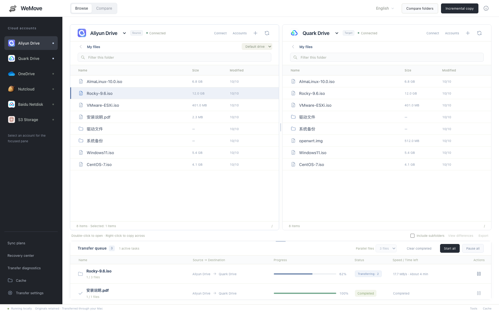
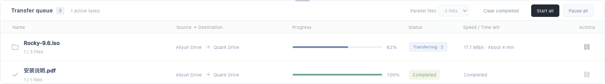

# WeMove

[English](README.md) · [简体中文](README.zh-CN.md)

A local, dual-pane cloud transfer tool for macOS. Current version: **0.9.0**. The macOS application is currently named **网盘搬运助手**.

Copy files between **Aliyun Drive, Quark Drive, OneDrive, Nutstore, Baidu Netdisk, iCloud Drive, Tencent Weiyun, 115 Drive, and S3-compatible storage** from one workspace.

Weiyun and 115 connect through an OpenList/WebDAV gateway; iCloud uses Apple ID and two-factor authentication. See [connection requirements and limitations](docs/extended-providers.md).

## Screenshots

Current interface, rendered with isolated demo files and tasks. No real account or user data is shown.

**Dual-pane workspace** — browse both drives, compare folders, and resize the file panes and transfer queue.



**Transfer queue** — progress, transfer speed, task states, and pause/resume controls in one view.



## Features

- Browse two cloud folders side by side; copy in either direction and upload local files by dragging them into a pane.
- Compare directories, preview a transfer, and copy missing or updated files. Supports one-way mirror sync mode and basic file filters (extension, size, exclude rules).
- Conflict handling: stop, overwrite, rename, or skip on name collisions.
- Extended server-side copy support where providers allow (same account preferred).
- Menu bar resident mode with background task continuation (app can minimize while transfers run).
- Optional basic Finder mount support for selected providers (experimental).
- Run multiple tasks with configurable file concurrency, per-account limits, automatic retries, and adaptive throttling.
- Pause and resume tasks. SQLite checkpoints preserve task state; supported providers can resume downloads or upload sessions.
- Connect multiple accounts and S3 buckets. Persisted credentials are encrypted with a key stored in macOS Keychain.
- Move items into the application's recovery folder, restore them, and export transfer verification reports.
- Switch between Chinese and English. Incremental plans can run manually or on a schedule while the application is running.

## Development

Requires **Node.js 22.13 or newer**. Follow the [build instructions (Chinese)](构建说明.md) to prepare third-party clients and bridges in `vendor/`, then run:

```sh
npm ci --omit=dev
npm start
npm test
```

The repository includes the web interface, Node.js service, Swift launcher, Go bridge sources, tests, and Quark scripts. Prebuilt clients, the Node.js binary, and packaged `.app` bundles are not included. Some integration tests require the corresponding vendor binaries.

Runtime data defaults to `~/Library/Application Support/PanMover`. Set `PANMOVER_DATA_DIR` to a separate directory for development so you do not modify everyday tasks.

## Transfer behavior and limitations

Most cross-cloud transfers download through your Mac before uploading. Keep the Mac and application running. Eligible transfers within the same provider and account can use server-side copy; this is not universal cross-cloud instant transfer.

Resume support varies by provider. Large S3 uploads and OneDrive uploads persist upload sessions; an expired session may require restarting the current file. Interrupted S3 multipart uploads can remain on the storage service; use bucket lifecycle rules or the provider console to clean them up when needed.

Verification reports distinguish hash verification, read-back verification, metadata checks, and unverified results. Provider compatibility and throughput depend on the service, account limits, and network; automated tests do not certify every real storage endpoint.

The current macOS application uses ad-hoc signing. A formal distribution still needs Developer ID signing and notarization.

## Documentation

- [User guide (Chinese)](使用说明.md)
- [Version 0.9.0 enhancements (Chinese)](增强功能使用说明-v0.9.0.md)
- [Version 0.8.0 enhancements (Chinese)](增强功能使用说明-v0.8.0.md)
- [Build instructions (Chinese)](构建说明.md)
- [Three interactive UI design concepts](designs/wemove-ui-concepts.html) — design exploration, not the released interface

## Licenses and private data

Third-party license files are retained in the repository; see the `*-LICENSE` files. No open-source license has been selected for WeMove's own code yet.

Do not commit account configurations, cookies, access keys, task records, or user files.
