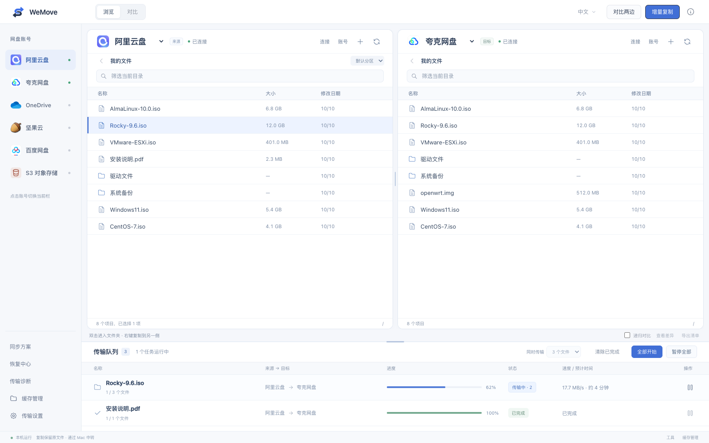
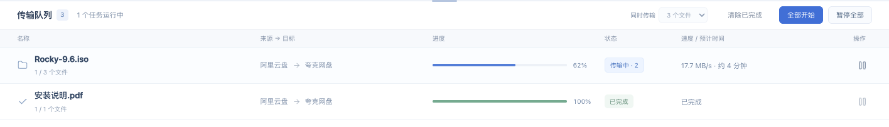

# WeMove

[English](README.md) · [简体中文](README.zh-CN.md)

面向 macOS 的本地双栏网盘搬运工具，当前版本 **0.8.0**。macOS 应用目前名为 **网盘搬运助手**。

在一个工作台中复制 **阿里云盘、夸克网盘、OneDrive、坚果云、百度网盘与 S3 兼容存储**之间的文件。

## 界面截图

截图来自当前界面，使用独立的示例文件与任务，不含真实账号或用户数据。

**双栏文件工作台**：浏览两侧网盘、对比目录，拖动调整文件栏宽度和队列高度。



**传输队列**：集中查看进度、速度和任务状态，支持暂停与恢复。



## 功能

- 双栏浏览云端目录，支持双向复制、拖拽本地文件上传。
- 对比目录，传输前预检，复制缺失或更新的文件。
- 多任务并行，可配置文件并发、账号限流，支持自动重试和自适应降速。
- 暂停和恢复任务，SQLite 检查点保存任务状态；支持的服务可续传下载或上传会话。
- 连接多个账号和 S3 Bucket；持久化凭据加密保存，密钥存入 macOS 钥匙串。
- 将项目移入应用回收目录、恢复文件，并导出传输验证报告。
- 中英文界面切换；增量方案支持手动或定时运行，应用需保持运行。

## 开发运行

需要 **Node.js 22.13 或更新版本**。根据[构建说明](构建说明.md)准备第三方客户端和桥接程序，放入 `vendor/`，然后运行：

```sh
npm ci --omit=dev
npm start
npm test
```

仓库包含网页界面、Node 服务、Swift 启动器、Go 桥接源码、测试和 Quark 脚本；不包含预编译客户端、Node 二进制和 `.app` 安装包。部分集成测试需要对应的 `vendor` 二进制。

默认运行数据目录为 `~/Library/Application Support/PanMover`。开发时可通过 `PANMOVER_DATA_DIR` 指向独立目录，避免修改日常任务。

## 传输方式与限制

跨网盘传输通常经 Mac 下载后上传，Mac 和应用需要保持运行。同一服务、同一账号内符合条件的任务可使用服务端复制，并非所有跨网盘传输都能秒传。

不同服务的续传能力不同。S3 大文件和 OneDrive 上传保存上传会话；会话失效时当前文件可能重传。中断的 S3 分片上传可能留在存储服务中，需要通过 Bucket 生命周期规则或服务商控制台清理。

验证报告区分哈希验证、回读验证、元数据检查与未验证结果。兼容性和速度受服务商、账号限制及网络影响；自动化测试不代表已认证所有真实存储端点。

当前 macOS 应用使用临时签名，正式发行尚需 Developer ID 签名和公证。

## 文档

- [使用说明](使用说明.md)
- [0.8.0 增强功能](增强功能使用说明-v0.8.0.md)
- [构建说明](构建说明.md)
- [三版交互式 UI 设计](designs/wemove-ui-concepts.html)——设计探索，尚非发布界面

## 许可证与隐私数据

第三方组件的许可证随仓库保留，参见各 `*-LICENSE` 文件。仓库暂未为 WeMove 自有代码指定开源许可证。

请勿提交账号配置、Cookie、访问密钥、任务记录或用户文件。
